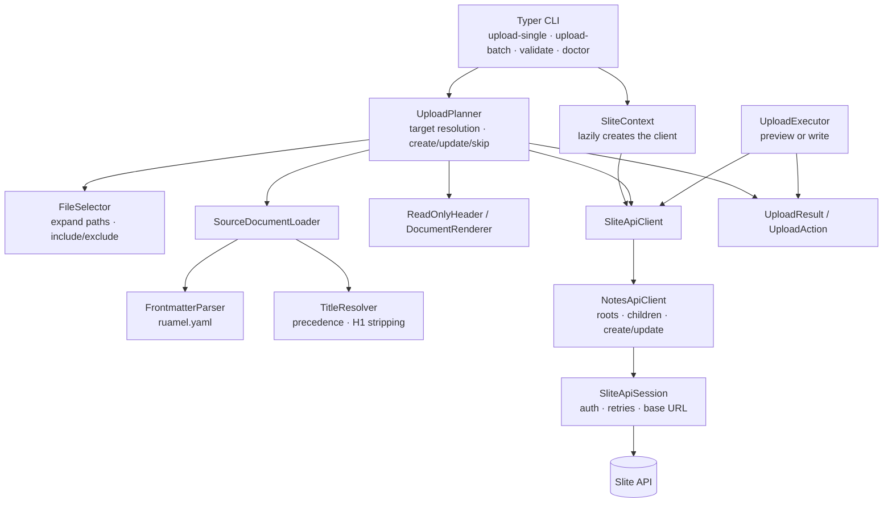

# slite-io

Mirror Markdown/MDX documentation from a Git repository into Slite notes.

`slite-io` is intended for documentation that lives in Git and is published to
Slite as a **read-only, clearly labelled mirror**. The Slite copy is generated
from the repository; manual edits in Slite are overwritten by the next sync.

**Status:** Phase 0 CLI implemented. See [`specs.md`](specs.md) for the full
design and future phases.

## Install and run

```bash
uv sync
uv run slite-io --help
uv run slite-io --version
```

For an isolated global command:

```bash
uv tool install .
slite-io --help
```

## Usage

- Upload one Markdown/MDX file to a specific Slite note.
- Upload a batch of files flat into an existing Slite folder.
- Resolve targets by title path, starting at a root channel:
  - `My private channel/Level 1/Level 2/Authentication`
- Find existing notes by title; skip by default, update with `--overwrite`.
- Preview by default; write only with `--apply`.
- Prepend a generated header with a read-only warning, an edit link to the Git
  repository, and the last sync timestamp.

CLI:

```bash
# Preview (default)
slite-io upload-single docs/api/auth.mdx \
  --target-note "My private channel/Level 1/Level 2/Authentication"

# Write
slite-io upload-single docs/api/auth.mdx \
  --target-note "My private channel/Level 1/Level 2/Authentication" \
  --header-edit-url "https://github.com/org/docs/edit/main/{filename}" --apply

slite-io upload-batch \
  --target-folder "My private channel/Level 1/Level 2" \
  --include-files "docs/**/*.md" --include-files "docs/**/*.mdx"

slite-io validate --include-files "docs/**/*.md"
slite-io doctor
```

`--upload-format markdown|sliteml` selects which Slite API content field receives
the body. Default is `markdown`. `sliteml` does not convert Markdown yet; it only
sends the existing body through the `sliteml` field.

Use `-v`, `-vv`, or `-vvv` for progressively more verbose logging:

```bash
slite-io -v upload-batch --include-files "docs/**/*.md" --target-folder "Channel/Docs"
```

- `-v`: debug logs with source paths.
- `-vv`: adds level, time, and local tracebacks.
- `-vvv`: includes third-party modules and logger names.

## Use as a Forgejo action

The repository root contains a composite `action.yml`. A consuming repository
only needs a workflow that checks out its own files and invokes this action.

```yaml
# .forgejo/workflows/sync-slite.yml
name: Sync Slite

on:
  workflow_dispatch:
  push:
    branches: [main]
    paths:
      - "docs/**"

jobs:
  sync:
    runs-on: docker
    steps:
      - name: Check out documentation
        uses: https://data.forgejo.org/actions/checkout@v7

      - name: Sync documentation
        uses: https://github.com/linkFISH-Consulting/slite-io@v1
        with:
          target-folder: "My private channel/Level 1/Level 2"
          # *.md* matches both .md and .mdx files.
          include-files: "docs/**/*.md*"
          exclude-files: "docs/drafts/**"
          header-edit-url: "${{ forgejo.server_url }}/${{ forgejo.repository }}/_edit/main/{filename}"
          slite-api-key: ${{ secrets.SLITE_API_KEY }}
```

The action accepts one include pattern and one exclude pattern per invocation.
Call it again for additional patterns. It always runs `upload-batch --apply`;
use the CLI directly for previews or single-note uploads.

| Input | Required | Default | Purpose |
|---|---|---|---|
| `target-folder` | yes | — | Absolute Slite folder path |
| `include-files` | yes | — | Single cwd-relative include glob |
| `exclude-files` | no | — | Single cwd-relative exclude glob |
| `header-edit-url` | no | — | Edit URL template with `{filename}` / `{file_basename}` |
| `upload-format` | no | `markdown` | `markdown` or `sliteml` |
| `overwrite` | no | `true` | Update existing notes instead of skipping |
| `slite-api-key` | yes | — | Slite API key |

Pin the action to a tag or commit for stable behavior. Pull requests from forks
do not receive repository secrets, so PR-triggered uploads only work for trusted
branches unless a separate secret broker is used.

## Limitations

Slite’s public API has no endpoint for per-note permissions, sharing, or
“protect editing”. “Read-only” is therefore a **convention**, not an enforced
Slite permission:

- every mirrored note starts with a generated warning header,
- the sync overwrites manual edits,
- the tool never claims to lock the note.

See the feature support matrix in [`specs.md`](specs.md#111-feature-support-matrix).

## Repository layout

```text
README.md
LICENSE                   # MIT
action.yml                # reusable Forgejo composite action
specs.md                  # full specification
open-questions.md         # questions for the Slite API team
src/slite_io/             # implementation
tests/unit/               # unit tests
examples/                 # feature-tour fixture
```


## Architecture



## Progress

- [x] Class-based API, document, selection, planning, and execution layers
- [x] `upload-single` with explicit target note path
- [x] `upload-batch` with cwd-relative include/exclude globs
- [x] Preview by default; `--apply` writes
- [x] Skip existing notes by default; `--overwrite` updates them
- [x] Resolve targets from personal or organization root channels
- [x] Generated read-only header with Git edit URL and sync timestamp
- [x] `--upload-format markdown|sliteml` API field selection
- [x] `validate` and `doctor` commands
- [x] Rich summary tables and `-v` / `-vv` / `-vvv` logging
- [x] Unit tests, linting, and type checks
- [ ] Markdown → SliteML translation (callouts, TOC, note links, diagrams)
- [ ] Image/asset upload and relative image rewriting
- [ ] Frontmatter and custom source metadata
- [ ] Note locking / API-only edit protection (blocked by public API)
- [ ] Interactive user mentions
- [ ] Directory-tree mirroring and folder notes
- [ ] Internal link rewriting
- [ ] Manifest-based identity, moves, and pruning
- [x] Forgejo reusable composite action and usage example
- [ ] PR-triggered sync workflow
- [ ] Integration tests against a test workspace
- [ ] Release packaging and changelog

Open API questions are tracked in [`open-questions.md`](open-questions.md).

## License

MIT. See [`LICENSE`](LICENSE).
