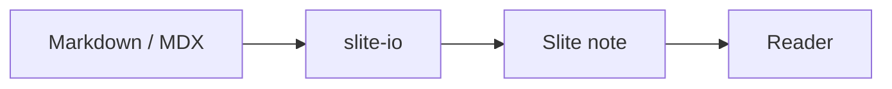

# slite-io Feature Tour

This file exercises the features slite-io is expected to mirror into Slite.
Features are grouped by what actually rendered during the manual test.

## Working

### Headings

#### Level 3 heading

##### Level 4 heading

Text with **bold**, *italic*, ~~strikethrough~~, `inline code`, and
[an external link](https://github.com/linkFISH-Consulting/slite-io).

### Lists and inline formatting

Use **bold text**, *italic text*, and `inline_code()` in normal prose.

- First bullet with **bold text**
  - Nested bullet with *italic text*
    1. Numbered sub-item with `inline code`
    2. Second numbered sub-item with **bold** and *italic*
  - Another nested bullet
- Second bullet
  1. First numbered child with `inline_code()`
  2. Second numbered child
  3. Third numbered child with **bold text**
- Third bullet

1. First numbered item
   - Nested bullet under a numbered item
   - Another nested bullet with *italic text*
2. Second numbered item
   1. Nested numbered item with `inline code`
   2. Another nested numbered item with **bold text**
3. Third numbered item

### Table

| Feature | Expected | Result |
|---|---|---|
| Headings | Render | Working |
| Lists | Render | Working |
| Tables | Render | Working |
| Mermaid | Rendered diagram | Working |
| Code | Render | Working |
| Links | Render | Working |
| Images | Render | Working |
| GitHub warning | Styled alert | Working |
| Checklist | Render | Working |

### Mermaid



### Code

```python
def hello(name: str) -> str:
    return f"hello {name}"

print(hello("slite-io"))
```

### Links

- External link: [slite-io repository](https://github.com/linkFISH-Consulting/slite-io)
- Relative link: [specification](../specs.md)
- Button-like call to action: [Open the repository](https://github.com/linkFISH-Consulting/slite-io)

Relative links are kept unchanged in Phase 0 and may be broken in Slite.

### Image


### GitHub warning

GitHub warning syntax renders as a styled alert in Slite and is used as the
generated read-only header:

> [!NOTE]
> Background information people should see, even when skimming.

> [!TIP]
> An optional shortcut or a better way to do something.

> [!IMPORTANT]
> Something people must know or do to succeed.

> [!WARNING]
> Something that needs attention right now to avoid problems.

> [!CAUTION]
> A risky action, like one that deletes data or can't be undone.

### Docusaurus admonitions

Docusaurus uses the `:::` admonition syntax. These are the standard variants:

:::note
Background information people should see, even when skimming.
:::

:::tip
An optional shortcut or a better way to do something.
:::

:::info
Useful context or additional details.
:::

:::caution
Something to be careful about.
:::

:::warning
Something that needs attention right now to avoid problems.
:::

:::danger
A risky action, like one that deletes data or can't be undone.
:::

### Checklist

- [x] Frontmatter parsed and removed from the body
- [x] Title derived from frontmatter
- [x] Leading H1 removed when it duplicates the title
- [x] Read-only header generated
- [x] Mermaid fenced block preserved
- [x] Tables and code blocks preserved
- [x] Relative links preserved unchanged
- [x] GitHub warning renders as a styled alert
- [ ] SliteML features need a different arg when uploading via api.

## Not working

### Nested manual toc

Nested bullet points cause Slite to create absolute (`https://...`) links during
import, making the links unusable in the frontend.

Slites Markdown parsing on Upload seems inconsistent. Sometimes, these become
proper `<note-link>` sometimes they dont.

- [Working](#working)
  - [Headings](#headings)
  - [Lists and inline formatting](#lists-and-inline-formatting)
  - [Table](#table)
  - [Mermaid](#mermaid)
  - [Code](#code)
  - [Links](#links)
  - [Image](#image)
  - [GitHub warning](#github-warning)
  - [Checklist](#checklist)
- [Not working](#not-working)
  - [Nested manual toc](#nested-manual-toc)
  - [Slite hint with `!!`](#slite-hint-with-)
  - [MDX pass-through](#mdx-pass-through)

### Slite hint with `!!`

The `!!` shortcut did not render as a Slite hint:

!! **This should have become a Slite hint block.**

### MDX pass-through

MDX is sent unchanged. The JSX is expected to be lost during processing.

<div className="mdx-example">
  <strong>This JSX wrapper was not rendered.</strong>
</div>

{/* MDX comment: also not rendered */}

## SliteML

SliteML is Slites extend Markdown format. It can optionally be selected for the
note upload endpoint (instead of plain `markdown`).
Concerning the vanilla Markdown features above, I did not notice any behavioral
changes when using the `sliteml` endpoint over the `markdown` endpoint. Only difference
seems, that more of the features below work (although not all).

Each feature is shown twice: first inside a fenced code block so the source is
readable, then directly beneath it so the block can render once the note was processed.

### Slite callout

```text
<callout type="note">
This is a native Slite hint block.
</callout>
```

<callout type="note">
This is a native Slite hint block.
</callout>

### Slite table of contents

```text
<table-of-contents />
```

<table-of-contents />

### Slite in-document heading link

Slite **should** convert a Markdown heading link such as `[Mermaid](#mermaid)` into a
native in-document link. This uses one of the headings already in this document.

I noticed that the links only work on _first imports_ (via API or manual import in GUI).
When _updating_ a note via the API the formats below break (same for the manual toc above).

Level 1:

```text
[slite-io Feature Tour](#slite-io-feature-tour)
```

[slite-io Feature Tour](#slite-io-feature-tour)

Level 2:

```text
[Working](#working)
```

[Working](#working)

Level 3:

```text
<a url="#mermaid">Jump to Mermaid</a>
```

<a url="#mermaid">Jump to Mermaid</a>

```text
[Jump to Mermaid](#mermaid)
```

[Jump to Mermaid](#mermaid)

### Slite mermaid diagram

```text
<diagram>flowchart LR
    A --> B
</diagram>
```

<diagram>flowchart LR
    A --> B
</diagram>

### Button-like link

There is no inline SliteML button block. A normal external link is the portable
substitute.

```text
<a url="https://github.com/linkFISH-Consulting/slite-io">Open the repository</a>
```

<a url="https://github.com/linkFISH-Consulting/slite-io">Open the repository</a>

### Tile endpoint (not inline)

Tiles are updated through a separate endpoint and require an existing tile ID
from the editor. They cannot be inserted at an arbitrary position through the
note body.

Would be nice if we could get tiles or real buttons via sliteml!

```text
PUT /notes/{noteId}/tiles/{tileId}
{
  "title": "Edit now",
  "url": "https://github.com/linkFISH-Consulting/slite-io",
  "content": "Open the source file in Git."
}
```
